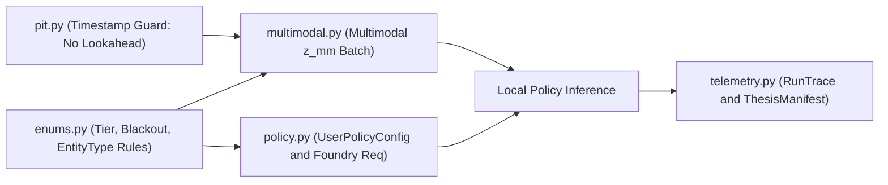

<div align="center">

[](./README.md)
[](./README.en.md)

[🇰🇷 한국어](./README.md) · [🇺🇸 English](./README.en.md)

</div>

# zerostreet-schema (`v0.2.0`) — Shared Data Contracts (Layer 0)

> **Stops lookahead bias at the data boundary and ensures every cloud and edge module speaks the exact same Pydantic v2 contract.**

---

## Why `zerostreet-schema`?

Quantitative AI tools commonly break for two structural reasons:

1. **Backtests look extraordinary while live trading underperforms** because restatements or future news leaked past the decision timestamp (`lookahead bias`).
2. **Cloud feature encoders, policy trainers, and local execution daemons drift apart** when subscription-tier limits, asset identifiers, and telemetry formats are duplicated across repositories.

**`zerostreet-schema` (Public MIT)** serves as Layer 0's single source of truth across `zerosteer`, `zerostreet-models`, `alphasmith`, `alphagraph`, and `zerostreet-mcp`.

---

## Contract Flow Overview



### Modules & Contracts

| Module | Key Types & Helpers | Responsibility |
| :--- | :--- | :--- |
| [`enums.py`](./src/zerostreet_schema/enums.py) | `SubscriptionTier`, `EntityType`, `HorizonMaskMode`, `DaemonStatus` | Tier-gated embedding dimensions (`allowed_embedding_dims`), entity normalization (`normalize_entity_type`), default modalities |
| [`pit.py`](./src/zerostreet_schema/pit.py) | `PointInTimeStamp`, `PointInTimeError`, `assert_no_lookahead`, `filter_pit_records` | Timezone-aware timestamp validation blocking `published_at > as_of_ts` |
| [`multimodal.py`](./src/zerostreet_schema/multimodal.py) | `AssetEmbeddingItem`, `MultimodalFeatureBatch`, `SourceDataPayload` | Tier-gated `z_mm` embedding vectors, blackout flags, and filing/macro source summaries |
| [`policy.py`](./src/zerostreet_schema/policy.py) | `UserPolicyConfig`, `RLRewardWeights`, `PolicyCompileRequest`, `PolicyCompileResult` | Customer risk/weight constraints and serverless Foundry policy-head compile specs |
| [`telemetry.py`](./src/zerostreet_schema/telemetry.py) | `RunTrace`, `KillCriterion`, `ThesisManifest` | Privacy-preserving execution telemetry (zero raw brokerage orders) and falsifiable thesis records |

---

## Verification

```bash
uv sync --extra dev
uv run ruff check .
uv run pytest -q
```

- Repository Wiki (Korean-primary): [./openwiki/quickstart.md](./openwiki/quickstart.md)
