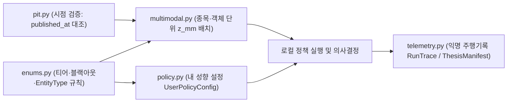

<div align="center">

[](./README.md)
[](./README.en.md)

[🇰🇷 한국어](./README.md) · [🇺🇸 English](./README.en.md)

</div>

# zerostreet-schema (`v0.2.0`) — 제로스트리트 공통 데이터 계약 계층 (Layer 0)

> **AI가 '아직 나오지 않은 미래 정보'로 반칙하지 못하게 막고, 클라우드와 내 PC가 서로 믿고 대화할 수 있게 만드는 공동 약속서입니다.**

---

## 왜 `zerostreet-schema`가 필요한가요?

투자용 AI 서비스를 쓰다 보면 소비자가 겪는 가장 억울한 문제는 두 가지입니다.

1. **백테스트에서는 수익률 100%였는데, 실전 계좌에서는 손실이 납니다.**  
   공시 정정이나 뒤늦게 나온 뉴스가 과거 날짜의 학습 데이터에 슬쩍 섞이는 '미래참조(Lookahead Bias)' 때문입니다. 눈가림 시뮬레이션을 막으려면 데이터가 **실제로 세상에 공개된 시각(`published_at`)**과 **우리가 판단을 내리는 시각(`as_of_ts`)**을 모든 단계에서 강제로 검사해야 합니다.
2. **구독 플랜(Developer/Sovereign Pro/Alpha Ultra/Founding 100)에 따른 차원 규칙과 안전장치가 서버·PC·스킬마다 제각각이면 오작동이 납니다.**  
   한쪽에서는 "주문이 없다"고 믿고, 다른 쪽에서는 다른 형식으로 데이터를 보내면 시스템 전체가 신뢰를 잃습니다.

**`zerostreet-schema`는 이 문제를 해결하는 ZeroStreet 생태계의 공통 언어(MIT 오픈소스)입니다.**  
`zerosteer`, `zerostreet-models`, `alphasmith`, `alphagraph`, `zerostreet-skills`가 모두 이 단 하나의 Pydantic v2 계약을 공유하기 때문에, 데이터 누수와 규격 불일치를 코드 실행 전에 원천 차단합니다.

---

## 데이터 흐름과 계약 구조 한눈에 보기



### 주요 모듈 구성

| 모듈 | 핵심 클래스 · 함수 | 역할 설명 |
| :--- | :--- | :--- |
| [`enums.py`](./src/zerostreet_schema/enums.py) | `SubscriptionTier`, `EntityType`, `HorizonMaskMode`, `DaemonStatus` | 구독 티어별 허용 벡터 차원(`allowed_embedding_dims`), 상장사·지수·매크로 객체 단위(`normalize_entity_type`)와 기본 모달리티 규정 |
| [`pit.py`](./src/zerostreet_schema/pit.py) | `PointInTimeStamp`, `PointInTimeError`, `assert_no_lookahead`, `filter_pit_records` | 타임존(`UTC`) 확인과 `published_at > as_of_ts` 미래 데이터 유입 즉시 차단 |
| [`multimodal.py`](./src/zerostreet_schema/multimodal.py) | `AssetEmbeddingItem`, `MultimodalFeatureBatch`, `SourceDataPayload` | 클라우드(`alphasmith`)가 로컬로 보내는 `z_mm` 임베딩, 블랙아웃 플래그, 공시·매크로 요약 페이로드 |
| [`policy.py`](./src/zerostreet_schema/policy.py) | `UserPolicyConfig`, `RLRewardWeights`, `PolicyCompileRequest`, `PolicyCompileResult` | 투자자의 리스크 선호·단일 종목 최대 비중 한도를 검증하고 파운드리 컴파일 요청 규격 정의 |
| [`telemetry.py`](./src/zerostreet_schema/telemetry.py) | `RunTrace`, `KillCriterion`, `ThesisManifest` | 계좌 주문·잔고 없이 모델 판단 근거와 손절 기준(`KillCriterion`)만 담는 투명한 감사 기록 |

---

## 설치 및 검증 명령

```bash
# 의존성 설치 및 린트·테스트 실행
uv sync --extra dev
uv run ruff check .
uv run pytest -q
```

- 상세 문서 및 도해: [OpenWiki 빠른 시작 (한국어)](./openwiki/quickstart.md) · [시점·멀티모달 계약](./openwiki/architecture/pit-and-multimodal-contracts.md) · [정책·텔레메트리 계약](./openwiki/architecture/policy-and-telemetry-contracts.md)
