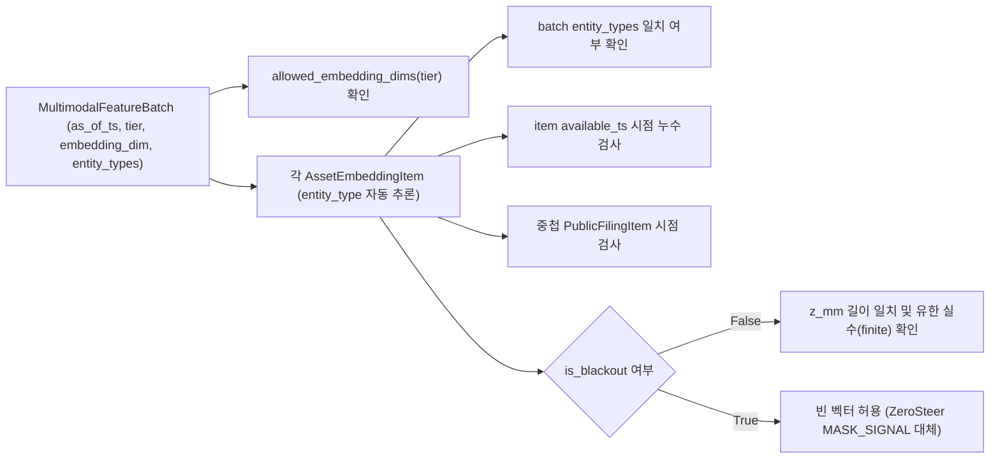

# 시점(PIT) 무결성 및 멀티모달 계약

`zerostreet-schema`는 제로스트리트 전체에서 **미래 시점 정보가 과거 학습·시뮬레이션에 몰래 섞이는 반칙(Lookahead Bias)**을 코드 수준에서 막고, 클라우드(`zerostreet-models` · `alphasmith`)가 만든 **ZeroLens** 멀티모달 요약 벡터(`z_mm`, 기본 버전 `zerolens_v2_mrl`)와 정제 원천 데이터를 로컬(`zerosteer` · `alphagraph`)로 안전하게 전달하는 공통 규칙을 정의합니다.

---

## 1. 3중 타임스탬프 Point-in-Time 규칙 (`pit.py`)

시간 순서를 엄격히 검증하기 위해 모든 시간 필드는 반드시 타임존 정보(`tzinfo`)가 포함된 UTC 등 timezone-aware `datetime` 객체여야 합니다. 타임존이 빠진 naive 시각이 들어오면 `ensure_timezone_aware`가 즉시 `PointInTimeError`를 일으킵니다 ([pit.py](../../src/zerostreet_schema/pit.py#L15-L95)).

```text
event_ts (실적·사건 기준 시각) <= published_ts (실제 공시·발표 시각) <= available_ts (모델 투입 가능 시각) <= as_of_ts (판단 기준 시각)
```

| 검증 도구 | 무엇을 확인하나요? | 위반 시 동작 |
| :--- | :--- | :--- |
| **`PointInTimeStamp`** | `event_ts` → `published_ts` → `available_ts` 순서가 뒤집히지 않았는지 검사 | Pydantic 검증 중 즉시 `PointInTimeError` 발생 |
| **`assert_no_lookahead`** | 단일 레코드의 `available_ts`가 판단 시점(`as_of_ts`)을 넘기지 않았는지 검사 | `PointInTimeError` 직접 발생 |
| **`filter_pit_records`** | 여러 데이터 중 `available_ts`가 `as_of_ts` 이하인 안전한 행만 선별 | 미래 시점 행을 자동 제외 |

---

## 2. 구독 티어별 MRL 차원 · 객체 단위 · 적법 데이터 소스 (`enums.py`)

하나의 **ZeroLens** 모델에서 앞쪽 차원만 잘라 구독 등급별로 다른 해상도의 `z_mm` 벡터를 제공하고, 종목뿐 아니라 지수·매크로·섹터·선물까지 일관된 객체 단위로 다룹니다 ([enums.py](../../src/zerostreet_schema/enums.py#L9-L146)).

### 구독 등급(`SubscriptionTier`)별 허용 차원 (`allowed_embedding_dims`)

| 등급 이름 | 허용 `embedding_dim` | 활용 범위 |
| :--- | :--- | :--- |
| **`developer`** | `{0, 32}` | 로컬 OHLCV 단독 블랙아웃 모드(`0`) 또는 경량 `32d` 요약 |
| **`sovereign_pro`** | `{0, 32, 128}` | 중차원 `128d` 멀티모달 벡터 및 공시·AI 팩트 |
| **`founding_100`** | `{0, 32, 128}` | `sovereign_pro`와 동일한 `128d` 초기 100인 전용 권한 |
| **`alpha_ultra`** | `{0, 32, 128, 256}` | 최고 해상도 `256d` 임베딩 및 글로벌 매크로 풀셋 |

### 객체 단위(`EntityType`)와 적법 소스(`AllowedDataSource`)

- **객체 단위 정규화 및 자동 추론**: `EntityType`은 `equity`, `index`, `macro`, `sector`, `futures` 다섯 가지를 지원합니다. `normalize_entity_type`은 레거시 별칭(`"asset"`은 `"equity"`, `"market_index"`는 `"index"`)까지 자동 정리하며, `infer_entity_type`은 `IDX:`, `MACRO:`, `FX:`, `SEC:`, `SECTOR:`, `FUT:` 접두어로 대상을 자동 판별하고 `default_modalities_for_entity`로 기본 모달리티를 결정합니다.
- **저작권·재배포 적법 소스 한정**: `AllowedDataSource`는 `OpenDART`, `SEC_EDGAR`, `BOK_ECOS`, `FRED`, `BOK_ECOS_FRED`, `PUBLIC_EXCHANGE`, `AI_EXTRACTED_FACTS`만 허용해 유료 언론 기사나 라이선스 위반 원천 유입을 막습니다.

---

## 3. 멀티모달 배치 검증 흐름 (`multimodal.py`)

`MultimodalFeatureBatch`와 `AssetEmbeddingItem`이 데이터를 주고받을 때 거치는 검증 절차는 다음과 같습니다 ([multimodal.py](../../src/zerostreet_schema/multimodal.py#L90-L209)).



- **블랙아웃 복원력 (`is_blackout=True`)**: 유료 임베딩을 쓰지 않거나 일시 결측이 생기면 빈 벡터(`[]`)를 정상 통과시켜, 로컬 `ZeroSteer`의 `DynamicEmbeddingAdapter`가 학습된 `[MASK_SIGNAL]` 토큰으로 부드럽게 대체하게 합니다.
- **수치 무결성 (`is_blackout=False`)**: 벡터 길이(`len(embedding_z_mm) == embedding_dim`)와 모든 원소의 유한성(`math.isfinite`)을 엄격하게 검증해 `NaN`/`Inf` 유입을 막습니다.

---

## 4. 테스트 검증

- [test_pit.py](../../tests/test_pit.py): 시간 역전, naive datetime, `assert_no_lookahead`, `filter_pit_records` 동작 검증
- [test_multimodal.py](../../tests/test_multimodal.py): 등급-차원 불일치(`developer` + `128d`) 거부, 미래 `available_ts` 차단, 블랙아웃 대체 및 비유한 값 방어 검증 ([tests/test_multimodal.py](../../tests/test_multimodal.py#L84-L166))

## 관련 문서

- [zerostreet-schema v0.2.0 개요 및 빠른 시작](../quickstart.md)
- [정책 · 파운드리 컴파일 및 텔레메트리 계약](./policy-and-telemetry-contracts.md)
