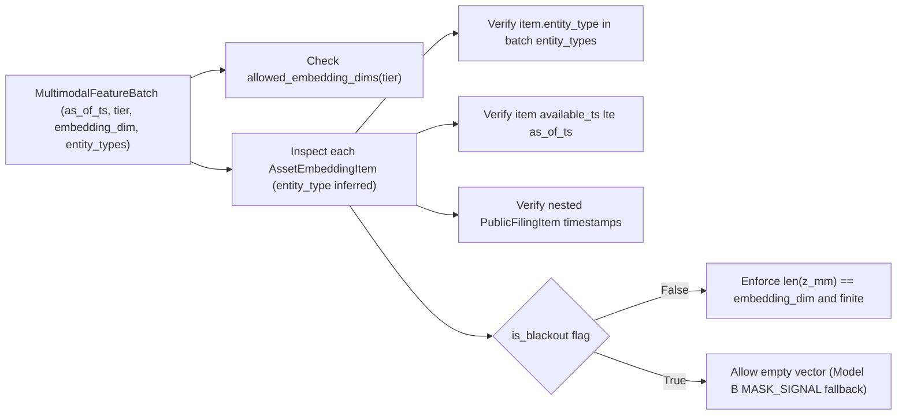

# Point-in-Time Validation & Multimodal Contracts / Point-in-Time 검증 및 멀티모달 임베딩 계약

`zerostreet-schema` defines the shared Pydantic v2 data contracts that block Look-Ahead Bias across the entire ZeroStreet stack and safely transport multimodal embeddings (`z_mm`) plus compliant source data from `zerostreet-models` / `AlphaSmith` (`Model A`) into `HyperAlpha-VLA` (`Model B`) and `AlphaGraph`.

`zerostreet-schema`는 ZeroStreet 생태계 전체에서 미래 참조(Look-Ahead Bias)를 차단하고 `zerostreet-models` / `AlphaSmith`(`Model A`)가 생성한 멀티모달 임베딩(`z_mm`)과 적법 원천 데이터를 `HyperAlpha-VLA`(`Model B`) 및 `AlphaGraph`로 안전하게 전달하기 위한 Pydantic v2 데이터 계약을 정의합니다.

---

## 1. Triple-Timestamp Point-in-Time Invariant (`pit.py`) / Point-in-Time 3중 타임스탬프 불변식

All time-sensitive fields must be timezone-aware `datetime` objects (`tzinfo` present); naive timestamps immediately raise `PointInTimeError(ValueError)` via `ensure_timezone_aware`.

모든 시점 민감 타임스탬프는 반드시 `tzinfo`가 포함된 timezone-aware `datetime`이어야 하며, 순수(naive) 시각이 들어오면 `ensure_timezone_aware`가 즉시 `PointInTimeError(ValueError)`를 발생시킵니다.

```text
event_ts (event/fiscal period) <= published_ts (public disclosure) <= available_ts (model ingestion) <= as_of_ts (inference cutoff)
```

| Component / 구성 요소 | Verification Rule / 검증 규칙 | Failure Behavior / 실패 시 동작 |
| :--- | :--- | :--- |
| **`PointInTimeStamp`** | Enforces `event_ts <= published_ts <= available_ts` ordering / 3중 시간 순서 검증 | Raises `PointInTimeError` via Pydantic / `PointInTimeError` 발생 |
| **`assert_no_lookahead`** | Asserts single-record `available_ts <= as_of_ts` / 개별 레코드 시점 누수 차단 | Raises `PointInTimeError` directly / `PointInTimeError` 직접 발생 |
| **`filter_pit_records`** | Retains only records with `available_ts <= as_of_ts` / 관측 가능 레코드만 필터링 | Excludes future rows automatically / 미래 레코드 자동 배제 |

---

## 2. Subscription Tier MRL Dimensions, Processing Units & Lawful Sources / 구독 티어 · 객체 단위 · 원천 소스 정책

`SubscriptionTier` determines allowed Matryoshka Representation Learning (MRL) dimensions via `allowed_embedding_dims()`, `EntityType` (`equity`, `index`, `macro`, `sector`, `futures`) defines the target financial processing unit (`infer_entity_type`, `normalize_entity_type`, `default_modalities_for_entity`), and `AllowedDataSource` restricts disclosures and macro inputs to legally redistributable sources ([`enums.py`](../../src/zerostreet_schema/enums.py#L9-L146)).

`SubscriptionTier`에 따라 `allowed_embedding_dims`가 허용하는 MRL 임베딩 차원이 결정되며, `EntityType`(`equity`, `index`, `macro`, `sector`, `futures`)은 모델 정보 처리 대상 객체 단위와 모달리티 가용 프로파일(`default_modalities_for_entity`)을 정의하고, `AllowedDataSource`는 재배포 적법 원천 데이터 소스만 허용합니다 ([`enums.py`](../../src/zerostreet_schema/enums.py#L9-L146)).

| Tier (`SubscriptionTier`) | Allowed `embedding_dim` | Commercial Purpose / 상업적 역할 |
| :--- | :--- | :--- |
| **`developer`** | `{0, 32}` | Local OHLCV blackout (`0d`) or lightweight `32d` summary / 로컬 수치 폴백 또는 경량 32차원 |
| **`sovereign_pro`** | `{0, 32, 128}` | Mid-dim multimodal embedding (`128d`) + disclosures & AI facts / 중차원 128d + 공시·AI 팩트 |
| **`founding_100`** | `{0, 32, 128}` | Early-adopter sovereign bundle matching `128d` quota / 초기 100인 전용 128차원 권한 |
| **`alpha_ultra`** | `{0, 32, 128, 256}` | Full `256d` embedding capacity + global macro context / 풀 256차원 임베딩 및 거시 데이터 |

---

## 3. Multimodal Batch & Entity-Unit Contract (`multimodal.py`) / 멀티모달 배치 및 객체 단위 계약



* **Entity-Type Normalization & Unit Consistency / 객체 단위 추론 및 일관성 검증**: `AssetEmbeddingItem` normalizes `entity_type` (including legacy aliases `"asset"` -> `"equity"`, `"market_index"` -> `"index"`) or infers it from `asset_id` prefix (`IDX:`, `MACRO:`/`FX:`, `SEC:`, `FUT:`), and `MultimodalFeatureBatch` auto-populates or strictly validates `entity_types` across all items ([`multimodal.py`](../../src/zerostreet_schema/multimodal.py#L90-L209)). (`AssetEmbeddingItem`은 `entity_type` 별칭을 정규화하거나 심볼 접두어에서 자동 추론하며, `MultimodalFeatureBatch`는 배치 내 `entity_types` 일치 여부를 검증하거나 자동 집계합니다.)
* **Blackout Resilience / 결측 안전성**: When `AssetEmbeddingItem.is_blackout=True`, an empty `embedding_z_mm` vector is accepted so `HyperAlpha-VLA`'s `DynamicEmbeddingAdapter` falls back to its learned `[MASK_SIGNAL]` token; when `is_blackout=False`, `MultimodalFeatureBatch` strictly enforces exact dimension length and `math.isfinite` on every scalar. (`is_blackout=True`이면 빈 벡터를 허용해 `Model B`가 `[MASK_SIGNAL]`로 대체하며, `False`이면 정확한 차원 일치와 유한 실수 여부를 검증합니다.)
* **Recursive Disclosure Check / 중첩 공시 검증**: Validates both top-level `item.available_ts` and nested `PublicFilingItem` timestamps against `as_of_ts`. (상위 항목뿐 아니라 내부 `public_filings`의 공시 시각까지 `as_of_ts` 이전인지 재귀 검증합니다.)

---

## 4. Unit Test Verification / 단위 테스트 검증 범위

* [test_pit.py](../../tests/test_pit.py): Verifies chronological violation rejection, naive datetime rejection, `assert_no_lookahead`, and `filter_pit_records`. (3중 타임스탬프 역전·naive 시각 거부 및 시점 필터링을 검증합니다.)
* [test_multimodal.py](../../tests/test_multimodal.py): Verifies tier-dimension mismatch rejection (`developer` + `128d`), future `available_ts` batch rejection, blackout fallback, and `NaN` guards. (티어 차원 불일치 차단, 미래 배치 거부, 블랙아웃 및 비유한 값 차단을 검증합니다.)

## Related Documentation / 관련 문서

* [zerostreet-schema Quickstart & Business Overview / 빠른 시작 및 비즈니스 개요](../quickstart.md)
* [Policy Compilation & Zero-Trust Telemetry Contracts / 정책 컴파일 및 텔레메트리 계약](./policy-and-telemetry-contracts.md)
