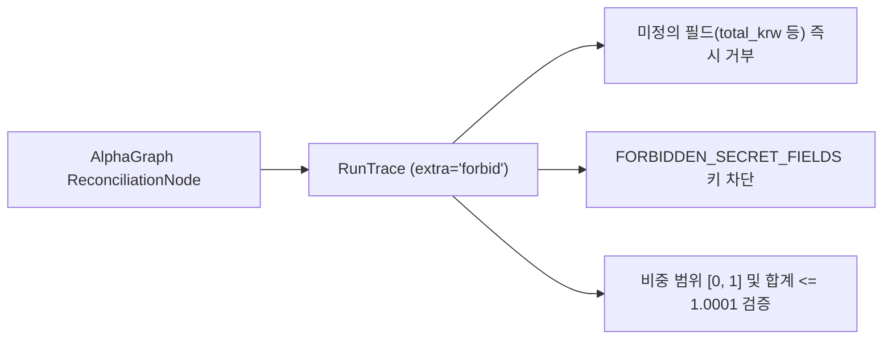

# 사용자 정책 계약 및 제로트러스트 텔레메트리 스키마

ZeroStreet는 자본시장법상 무인가 투자자문·일임업 리스크를 구조적으로 차단하기 위해, **사용자 에이전트가 직접 유니버스와 보상 가중치를 명시**하도록 강제하는 `policy.py` 계약과 **계좌·시크릿 정보 유출을 금지**하는 `telemetry.py` 계약을 분리하여 운용합니다.

---

## 1. 사용자 개별 정책 컴파일 계약 (`policy.py`)

| 모델 | 책임 및 검증 불변식 |
| :--- | :--- |
| **`RLRewardWeights`** | 모든 수익·리스크 가중치(`excess_return_20`, `sortino_20`, `cvar_20`, `mdd_20` 등)는 `>= 0.0`이어야 하며, `_validate_non_zero_objective`를 통해 핵심 목적함수 합계가 `> 0.0`인지 검증합니다. |
| **`UserPolicyConfig`** | `target_universe`는 공백 제거 후 최소 2개의 중복 없는 고유 심볼을 포함해야 하며, `portfolio_horizon`(1~64일), `horizon_mask_mode`(`HorizonMaskMode`), `weights_output_mode`(`entmax15`/`sparsemax`/`softmax`), `max_single_weight`를 정의합니다. |
| **`PolicyCompileRequest` / `PolicyCompileResult`** | `AlphaSmith` Serverless RL Foundry에 유저 ID·구독 티어·`UserPolicyConfig`를 전달해 유저 전용 Policy Head 체크포인트(`policy_checkpoint_id`, `checkpoint_sha256`, `artifact_uri`)를 발급받는 입출력 계약입니다. |

이 계약을 통해 회사가 미리 정한 종목 추천이나 기본 Policy 가중치 없이도, 유저 에이전트가 `HyperAlpha-VLA` 및 `AlphaSmith Foundry`에 자신의 목적함수를 안전하게 전달할 수 있습니다.

---

## 2. 제로 트러스트 `RunTrace` 텔레메트리 (`telemetry.py`)

`AlphaGraph`가 매 리밸런싱 실행 후 생성하여 로컬 SQLite에 저장하고, 유료 클라우드 연동 시 `AlphaSmith`로 전송하는 익명 실행 스냅샷입니다.

- **엄격한 스키마 폐쇄 (`ConfigDict(extra="forbid")`)**: 선언되지 않은 필드가 페이로드에 포함되면 즉시 `ValidationError`가 발생합니다.
- **금지 키 차단 (`FORBIDDEN_SECRET_FIELDS`)**: `account_number`, `kis_cano`, `app_key`, `kis_app_key`, `app_secret`, `kis_app_secret`, `total_krw`, `total_balance_krw`, `order_amount_krw`, `api_key`, `secret_key`가 `positions_weights` 또는 `target_vs_filled_diff_bps` 키에 포함되면 검증이 실패합니다.
- **심플렉스 비중 상한 검증**: 각 자산 비중은 `[0.0, 1.0]` 범위에 있어야 하며, 전체 합은 부동소수점 허용 오차를 포함해 `1.0001` 이하로 제한됩니다.

---

## 3. `alpha-wiki` 리서치 매니페스트 (`ThesisManifest` v2.0)

`ThesisManifest` (`schema_version="2.0"`)는 로컬 리서치 보조 모듈(`alpha-wiki`)과 `AlphaGraph` HITL 승인을 연결하는 구조화 결과물입니다.

- **`run_trace_ref` (`RunTraceRef`)**: 실행 ID, `policy_checkpoint_id`, 멀티모달 텐서 버전, 목표 비중 변화폭(`target_weight_delta`)을 참조합니다.
- **`source_facts_snapshot` (`SourceFactsSnapshot`)**: `available_ts`가 timezone-aware인지 검증하며, 이벤트 태그와 톤/리스크 스코어를 보존합니다.
- **`core_fact_summary` / `devils_advocate_risks` / `quantitative_kill_criteria`**: 최소 1개 이상의 객관적 팩트 요약, 사전 부검 반론, 정량적 가설 파기 조건(`KillCriterion`)을 필수로 요구합니다.

---

## 4. 단위 테스트 검증 범위

<!-- openwiki: broken internal link [../tests/test_policy.py] file "../tests/test_policy.py" does not exist. Fix the href or restore the target, then delete this comment. -->
- [test_policy.py](../tests/test_policy.py): 0 이하 목적함수 가중치 합계 거부, 중복/단일 종목 유니버스 거부 및 정상 `PolicyCompileRequest` 생성을 검증합니다.
<!-- openwiki: broken internal link [../tests/test_telemetry.py] file "../tests/test_telemetry.py" does not exist. Fix the href or restore the target, then delete this comment. -->
- [test_telemetry.py](../tests/test_telemetry.py): `RunTrace`의 `extra="forbid"` 필드(`total_krw`), `kis_app_key` 키 주입, 비중 합 `> 1.0001` 거부와 `ThesisManifest` v2.0 검증을 수행합니다.
