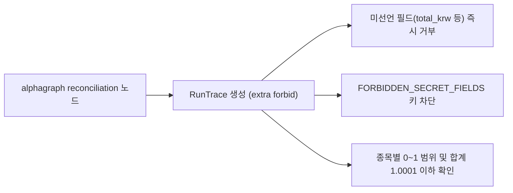

# 정책 · 파운드리 컴파일 및 텔레메트리 계약

자본시장법상 무등록 투자자문·일임업 리스크를 구조적으로 없애고, 고객의 증권사 계좌 정보가 클라우드로 새어 나가지 않게 하려면 두 가지 규칙이 반드시 필요합니다.
`policy.py`는 **투자자가 직접 대상 종목과 보상 기준을 명시하도록 강제**하고, `telemetry.py`는 **실행 기록(`RunTrace`)에 계좌번호·API 키·잔고 총액이 들어갈 수 없도록 원천 차단**합니다.

---

## 1. 사용자 맞춤 정책 및 파운드리 컴파일 계약 (`policy.py`)

회사가 임의로 정한 종목 추천 기본값을 두지 않으므로, 사용자는 자기 에이전트를 통해 아래 계약 모델로 투자 규칙을 전달합니다 ([policy.py](../../src/zerostreet_schema/policy.py#L14-L93)).

| 모델 | 주요 검증 규칙 |
| :--- | :--- |
| **`RLRewardWeights`** | 수익률(`excess_return_20`, `sortino_20`)과 리스크(`cvar_20`, `mdd_20` 등) 가중치는 모두 `0.0` 이상이어야 하며, 핵심 목적함수 가중치의 합이 반드시 `0.0`보다 커야(`_validate_non_zero_objective`) 합니다. |
| **`UserPolicyConfig`** | `target_universe`에 공백을 뺀 고유 종목 심볼을 **최소 2개 이상** 요구하며, `portfolio_horizon`(1~64), `horizon_mask_mode`(`HorizonMaskMode`), `weights_output_mode`(`entmax15` · `sparsemax` · `softmax`), `max_single_weight` 상한을 검증합니다. |
| **`PolicyCompileRequest` / `PolicyCompileResult`** | 고객 에이전트와 `alphasmith` 서버리스 RL 파운드리 사이의 입출력 계약입니다. 기본 `backbone_version="zerosteer-backbone-v1"` 및 `multimodal_tensor_version="zerolens_v2_mrl"` 기준으로 컴파일을 요청하고 `policy_checkpoint_id`, `checkpoint_sha256`, `artifact_uri`를 돌려받습니다. |

---

## 2. 계좌·시크릿 차단 제로 트러스트 텔레메트리 (`telemetry.py`)

`alphagraph`가 매 리밸런싱 사이클을 끝내면 로컬 SQLite에 `RunTrace`를 남기고, 클라우드 관측을 켠 사용자에 한해 `alphasmith`로 익명 주행기록을 보냅니다 ([telemetry.py](../../src/zerostreet_schema/telemetry.py#L11-L70)).

- **닫힌 스키마 (`ConfigDict(extra="forbid")`)**: 스키마에 정의되지 않은 `total_krw` 같은 필드가 실수로 들어가도 즉시 `ValidationError`를 냅니다.
- **금지 키 원천 차단 (`FORBIDDEN_SECRET_FIELDS`)**: 비중 또는 슬리피지 딕셔너리 키에 `account_number`, `kis_cano`, `app_key`, `kis_app_key`, `app_secret`, `kis_app_secret`, `total_krw`, `total_balance_krw`, `order_amount_krw`, `api_key`, `secret_key`가 섞이면 거부합니다.
- **포트폴리오 비중 상한**: 개별 종목 비중 `[0.0, 1.0]` 범위와 전체 비중 합계 `1.0001` 이하를 강제합니다.

---

## 3. 오프라인 리서치 매니페스트 (`ThesisManifest` v2.0)

장중 매매와 분리된 리서치 도구 `alpha-wiki`가 생성하는 구조화 보고서 규격입니다 ([telemetry.py](../../src/zerostreet_schema/telemetry.py#L72-L132)).

- **`schema_version="2.0"`**: 실행과 리서치를 연결하는 표준 버전입니다.
- **`run_trace_ref` (`RunTraceRef`)**: `run_id`, `policy_checkpoint_id`, 멀티모달 텐서 버전, `target_weight_delta`를 연결합니다.
- **`source_facts_snapshot` (`SourceFactsSnapshot`)**: 타임존이 검증된 `available_ts`, 이벤트 태그, 톤/리스크 스코어를 보존합니다.
- **균형 잡힌 검증 요소**: 최소 1개 이상의 객관적 사실 요약(`core_fact_summary`), 반대 시각의 리스크 반론(`devils_advocate_risks`), 정량적 손절·파기 기준(`quantitative_kill_criteria`: `KillCriterion`)을 모두 채워야 유효합니다.

---

## 4. 단위 테스트 검증

- [test_policy.py](../../tests/test_policy.py): 0 이하 목적함수 합계, 단일·중복 종목 유니버스 차단 및 정상 `PolicyCompileRequest` 직렬화 검증
- [test_telemetry.py](../../tests/test_telemetry.py): `extra="forbid"`(`total_krw`), `FORBIDDEN_SECRET_FIELDS`(`kis_app_key`), 비중 합계 초과 차단 및 `ThesisManifest` v2.0 검증

## 관련 문서

- [zerostreet-schema v0.2.0 개요 및 빠른 시작](../quickstart.md)
- [시점(PIT) 무결성 및 멀티모달 계약](./pit-and-multimodal-contracts.md)
