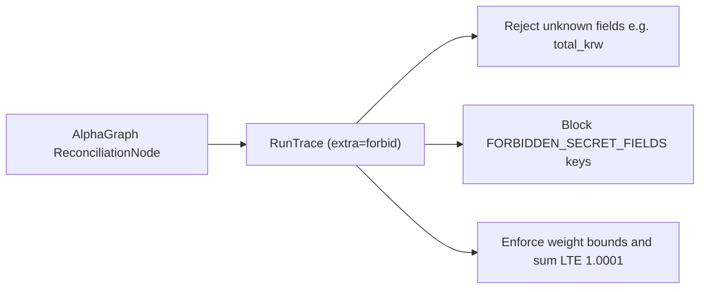

# Policy Compilation & Zero-Trust Telemetry Contracts / 정책 컴파일 및 제로 트러스트 텔레메트리 계약

To eliminate unlicensed investment-advisory and discretionary management risks under capital market regulations, ZeroStreet separates the `policy.py` contract (forcing user agents to explicitly supply universes and reward weights) from the `telemetry.py` contract (forbidding account credentials and balance fields from ever entering cloud telemetry).

ZeroStreet는 자본시장법상 무인가 투자자문·일임업 리스크를 구조적으로 차단하기 위해, **사용자 에이전트가 직접 유니버스와 보상 가중치를 명시**하도록 강제하는 `policy.py` 계약과 **계좌·시크릿 정보 유출을 금지**하는 `telemetry.py` 계약을 분리하여 운용합니다.

---

## 1. User-Supplied Policy Compilation Contracts (`policy.py`) / 사용자 개별 정책 컴파일 계약

| Model / 모델 | Responsibility & Validation Invariant / 책임 및 검증 불변식 |
| :--- | :--- |
| **`RLRewardWeights`** | All return/risk weights (`excess_return_20`, `sortino_20`, `cvar_20`, `mdd_20`, etc.) must be `>= 0.0`, and `_validate_non_zero_objective` enforces that the objective total is strictly `> 0.0`. / 모든 수익·리스크 가중치는 0 이상이어야 하며 핵심 목적함수 합계가 반드시 양수(`> 0.0`)여야 합니다. |
| **`UserPolicyConfig`** | Enforces at least 2 distinct non-empty symbols in `target_universe`, `portfolio_horizon` (`1..64`), `horizon_mask_mode` (`HorizonMaskMode`), `weights_output_mode` (`entmax15` / `sparsemax` / `softmax`), and `max_single_weight`. / 공백 제거 후 최소 2개 고유 심볼, 기간(1~64), 마스킹/활성화 모드를 검증합니다. |
| **`PolicyCompileRequest` / `PolicyCompileResult`** | Request/response contract between client agents and `AlphaSmith` Serverless RL Foundry (default `multimodal_tensor_version="zerolens_v2_mrl"`) to issue a personalized `policy_checkpoint_id`, `checkpoint_sha256`, and `artifact_uri`. / 고객 맞춤형 Policy Head 컴파일 요청(기본 `multimodal_tensor_version="zerolens_v2_mrl"`) 및 체크포인트 발급 입출력 계약입니다. |

This schema boundary allows customer agents to configure `HyperAlpha-VLA` and `AlphaSmith Foundry` safely without any vendor-preset strategy weights.

이 계약을 통해 회사가 미리 정한 종목 추천이나 기본 Policy 가중치 없이도, 유저 에이전트가 `HyperAlpha-VLA` 및 `AlphaSmith Foundry`에 자신의 목적함수를 안전하게 전달할 수 있습니다.

---

## 2. Zero-Trust `RunTrace` Telemetry (`telemetry.py`) / 제로 트러스트 실행 텔레메트리

`RunTrace` is emitted locally to SQLite after every `AlphaGraph` rebalancing run and optionally synced to `AlphaSmith` for ex-post attribution.

`RunTrace`는 `AlphaGraph`가 매 리밸런싱 실행 후 생성하여 로컬 SQLite에 저장하고, 유료 클라우드 연동 시 `AlphaSmith`로 전송하는 익명 실행 스냅샷입니다.

* **Closed Schema (`ConfigDict(extra="forbid")`) / 엄격한 스키마 폐쇄**: Rejects any undeclared payload keys with `ValidationError`. (선언되지 않은 필드가 포함되면 즉시 거부합니다.)
* **Blocked Credential Keys (`FORBIDDEN_SECRET_FIELDS`) / 금지 키 차단**: Forbids `account_number`, `kis_cano`, `app_key`, `kis_app_key`, `app_secret`, `kis_app_secret`, `total_krw`, `total_balance_krw`, `order_amount_krw`, `api_key`, and `secret_key` in weight/diff maps. (계좌번호·API 키·원화 총액 키 주입을 차단합니다.)
* **Simplex Weight Ceiling / 심플렉스 비중 상한**: Enforces per-asset bounds `[0.0, 1.0]` and total weight `<= 1.0001`. (각 비중 `[0, 1]` 범위와 총합 `1.0001` 이하를 강제합니다.)

---

## 3. `alpha-wiki` Research Manifest (`ThesisManifest` v2.0) / 구조화 리서치 매니페스트

`ThesisManifest` (`schema_version="2.0"`) links the offline research cold-path (`alpha-wiki`) with `AlphaGraph` HITL confirmation.

`ThesisManifest` (`schema_version="2.0"`)는 로컬 리서치 보조 모듈(`alpha-wiki`)과 `AlphaGraph` HITL 승인을 연결하는 구조화 결과물입니다.

* **`run_trace_ref` (`RunTraceRef`)**: Links `run_id`, `policy_checkpoint_id`, multimodal tensor version, and `target_weight_delta`. (실행 ID, 체크포인트 ID, 텐서 버전, 비중 변화폭을 연결합니다.)
* **`source_facts_snapshot` (`SourceFactsSnapshot`)**: Validates timezone-aware `available_ts` alongside event tags and tone/risk scores. (`available_ts` 시점 검증 및 이벤트 태그·톤/리스크 스코어를 보존합니다.)
* **`core_fact_summary` / `devils_advocate_risks` / `quantitative_kill_criteria`**: Requires at least one descriptive fact item, one adversarial rebuttal, and one quantitative `KillCriterion`. (최소 1개 이상의 객관적 팩트 요약, 반론, 정량적 파기 조건을 필수로 요구합니다.)

---

## 4. Unit Test Verification / 단위 테스트 검증 범위

* [test_policy.py](../../tests/test_policy.py): Verifies rejection of all-zero reward objectives and single/duplicate asset universes alongside valid `PolicyCompileRequest` construction. (0 이하 목적함수 합계 및 중복/단일 종목 유니버스 거부, 정상 요청 생성을 검증합니다.)
* [test_telemetry.py](../../tests/test_telemetry.py): Verifies `extra="forbid"` (`total_krw`), `FORBIDDEN_SECRET_FIELDS` (`kis_app_key`), weight sum `> 1.0001` rejection, and `ThesisManifest` v2.0 validation. (금지 필드/키 주입 차단, 비중 상한 검증 및 `ThesisManifest` v2.0 유효성을 검증합니다.)

## Related Documentation / 관련 문서

* [zerostreet-schema Quickstart & Business Overview / 빠른 시작 및 비즈니스 개요](../quickstart.md)
* [Point-in-Time Validation & Multimodal Contracts / 시점 검증 및 멀티모달 계약](./pit-and-multimodal-contracts.md)
