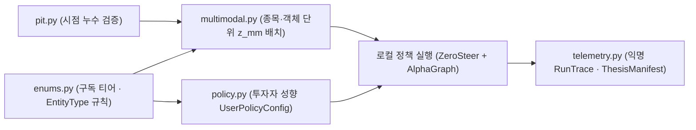

# zerostreet-schema v0.2.0 개요 및 빠른 시작

## 왜 이 프로젝트가 필요한가요? (비즈니스 역할 및 소비자 가치)

`zerostreet-schema`(`v0.2.0`, Public MIT)는 **주식회사 제로스트리트(ZeroStreet Inc.)**의 클라우드(`zerostreet-models` · `alphasmith`)와 투자자 PC(`zerosteer` · `alphagraph` · `zerostreet-skills`)가 서로 다른 언어로 오해하지 않도록 묶어 주는 **Layer 0 공통 데이터 계약**입니다.

소비자 입장에서 이 패키지가 지켜 주는 핵심 가치는 세 가지입니다.
1. **눈가림 백테스트(미래참조) 차단**: 실적 정정이나 미래 뉴스가 과거 판단 시점(`as_of_ts`) 안으로 섞여 들어오지 못하도록 `PointInTimeStamp`와 `assert_no_lookahead`로 모든 데이터의 발표 시각 순서를 강제합니다.
2. **구독 등급별 공정한 품질 보장**: `SubscriptionTier`와 `allowed_embedding_dims()`가 `developer`(`{0, 32}`), `sovereign_pro`·`founding_100`(`{0, 32, 128}`), `alpha_ultra`(`{0, 32, 128, 256}`) 차원을 명시해 단일 ZeroLens 모델에서 투명하게 등급별 벡터를 서빙합니다.
3. **계좌 정보 유출 및 무인가 자문 방지**: `UserPolicyConfig`는 회사가 정한 기본 매수 가중치를 두지 않고 고객이 투자 대상과 리스크 가중치를 직접 입력하게 하며, `RunTrace`는 계좌번호·API 키·원화 총액 키가 들어오면 즉시 거부(`extra="forbid"`)합니다.

---

## 계약 흐름 한눈에 보기



---

## 패키지 모듈 구성 (`src/zerostreet_schema/`)

| 모듈 | 주요 심볼 | 핵심 역할 |
| :--- | :--- | :--- |
| [`enums.py`](../src/zerostreet_schema/enums.py) | `SubscriptionTier`, `allowed_embedding_dims`, `AllowedDataSource`, `DaemonStatus`, `HorizonMaskMode`, `EntityType`, `normalize_entity_type`, `infer_entity_type`, `default_modalities_for_entity` | 구독 티어 차원 규칙, 재배포 허용 원천, 금융 객체 단위(`equity`/`index`/`macro`/`sector`/`futures`) 및 데몬 상태 정의 |
| [`pit.py`](../src/zerostreet_schema/pit.py) | `PointInTimeError`, `PointInTimeStamp`, `ensure_timezone_aware`, `assert_no_lookahead`, `filter_pit_records` | 타임존 필수 검사 및 `event_ts <= published_ts <= available_ts <= as_of_ts` 시점 검증 |
| [`multimodal.py`](../src/zerostreet_schema/multimodal.py) | `PublicFilingItem`, `MacroContextPayload`, `AIExtractedFactsPayload`, `SourceDataPayload`, `AssetEmbeddingItem`, `MultimodalFeatureBatch` | `zerolens_v2_mrl` 기반 임베딩(`z_mm`), `entity_types`, 공시·거시 원천 페이로드 계약 |
| [`policy.py`](../src/zerostreet_schema/policy.py) | `RLRewardWeights`, `UserPolicyConfig`, `PolicyCompileRequest`, `PolicyCompileResult` | 투자자 맞춤형 정책 헤드 컴파일 요청과 비영(non-zero) 목적함수 검증 |
| [`telemetry.py`](../src/zerostreet_schema/telemetry.py) | `FORBIDDEN_SECRET_FIELDS`, `RunTrace`, `KillCriterion`, `RunTraceRef`, `SourceFactsSnapshot`, `ThesisManifest` | 계좌 비밀정보 차단 텔레메트리 및 `alpha-wiki`용 `ThesisManifest` v2.0 스키마 |

---

## 세부 문서 안내

- [시점(PIT) 무결성 및 멀티모달 계약](./architecture/pit-and-multimodal-contracts.md)
- [정책 · 파운드리 컴파일 및 텔레메트리 계약](./architecture/policy-and-telemetry-contracts.md)
- [저장소 영문·국문 대문 README](../README.md)

---

## 설치 및 검증 방법

[pyproject.toml](../pyproject.toml)은 Python `>=3.11`, `hatchling` 빌드 백엔드, 런타임 의존성(`pydantic>=2.7.0`, `loguru>=0.7.2`) 및 개발 의존성(`pytest`, `ruff`)을 사용합니다.

```bash
uv sync --dev
uv run ruff check .
uv run pytest -q
```
